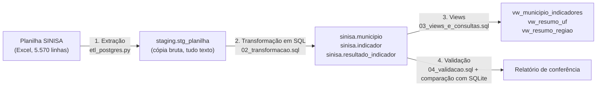
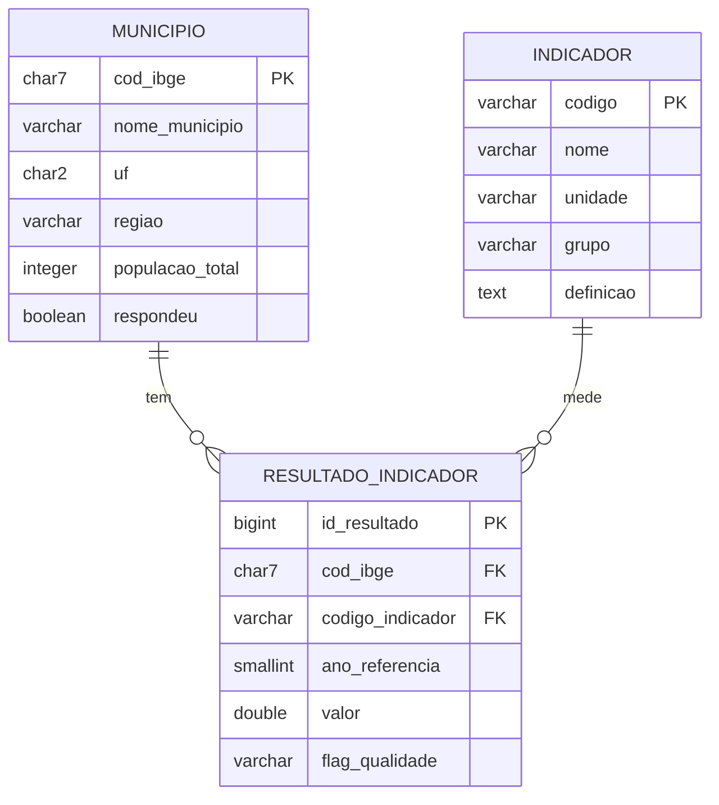

# Banco de dados do projeto (PostgreSQL)

Este documento descreve como os dados do SINISA 2025 (ano de referência 2024) foram extraídos, limpos, carregados e estruturados no banco **PostgreSQL** `residuos_sinisa`. O dashboard publicado continua lendo uma cópia em SQLite (`dados_tratados/projeto_residuos.db`), porque o serviço de publicação não alcança um Postgres local. As duas cargas partem da mesma planilha e foram conferidas entre si (ver "Validação").

## 1. Pipeline



Por que um staging? Guardar a planilha como veio permite auditar a carga (toda linha tem `linha_origem`) e fazer a limpeza em SQL, no próprio banco, sem alterar a origem.

## 2. Modelo de dados (esquema estrela)



Decisões de modelagem:
- **Dimensões desnormalizadas de propósito** (esquema estrela): `regiao` fica em `municipio`, embora dependa de `uf`.
- **Fato em formato longo:** uma linha por município x indicador x ano. Acrescentar um indicador novo não exige alterar a tabela.
- **Município sem resposta** continua em `municipio` (`respondeu = false`), mas não tem linhas na fato.

### Restrições de integridade
| Tabela | Restrições |
|---|---|
| `municipio` | PK `cod_ibge`; `cod_ibge` com 7 dígitos; `uf` com 2 letras maiúsculas; `regiao` entre as 5 macrorregiões; população >= 0 |
| `indicador` | PK `codigo`; `unidade` em (`Percentual`, `Kg/hab.dia`); `grupo` em (`Cobertura`, `Operacional`, `Qualidade`) |
| `resultado_indicador` | PK identidade; FK para município e indicador; `UNIQUE (cod_ibge, codigo_indicador, ano_referencia)`; `valor >= 0`; `flag_qualidade` restrita a dois valores |

Índices: `idx_municipio_uf`, `idx_resultado_indicador`, `idx_resultado_municipio`. O plano de execução de uma consulta por indicador usa o índice (`Bitmap Index Scan`, cerca de 1 ms para 4.854 linhas).

## 3. Regras de limpeza (em SQL, `02_transformacao.sql`)
1. **Código IBGE:** remove espaços e a parte decimal (`3548708.0` vira `3548708`); descarta linhas sem 7 dígitos; em duplicata, fica a primeira.
2. **Texto:** `trim`; UF em maiúsculas; `respondeu` vira booleano (`Sim` = verdadeiro).
3. **Indicadores:** só entram valores numéricos; `null`, vazio e traço são descartados.
4. **Qualidade, sem apagar nada:** percentual acima de 100 recebe `PERCENTUAL_ACIMA_100`; IRS1004 acima de 3 kg/hab.dia recebe `MASSA_PER_CAPITA_ALTA`.

## 4. Segurança básica
- Papel `leitor_sinisa`: só `SELECT` no schema `sinisa`. Foi testado: consulta as views e é barrado ao tentar `DELETE`.
- O servidor portátil escuta apenas em `localhost` e usa autenticação `trust`, o que é adequado a um banco local de estudo e **não** a produção.

## 5. Como reproduzir (Windows, sem administrador)
```powershell
.\scripts\postgres_portatil.ps1 instalar     # uma vez: baixa o PostgreSQL portátil (~320 MB)
.\scripts\postgres_portatil.ps1 iniciar      # liga o servidor em localhost:5433
pip install -r requirements-postgres.txt
python scripts\etl_postgres.py               # recria o banco a partir da planilha e valida
```
Atalho, sem rodar o ETL: `.\scripts\postgres_portatil.ps1 restaurar` recria o banco a partir de `dados_tratados/postgres/residuos_sinisa.sql` (dump gerado com `pg_dump`). Para abrir o console SQL: `.\scripts\postgres_portatil.ps1 psql`. O zip do PostgreSQL também traz o pgAdmin 4, em `%USERPROFILE%\tools\pg\pgsql\pgAdmin 4`, útil para mostrar tabelas e relacionamentos na apresentação.

## 6. Validação (resultado da última carga)
O ETL compara o Postgres com o SQLite. Todos os totais batem:

| Conferência | SQLite | PostgreSQL |
|---|---|---|
| Municípios | 5.570 | 5.570 |
| Respondentes | 4.854 | 4.854 |
| Resultados (fato) | 29.124 | 29.124 |
| Resultados sinalizados | 63 | 63 |
| Soma da população | 212.583.750 | 212.583.750 |
| Indicadores IRS (n e soma) | iguais nos 6 | iguais nos 6 |

Também bate com o dashboard: IRS3002 em SP, média simples 6,71% e ponderada 7,89%.

## 7. Limitações
- O SQLite continua sendo a base do dashboard publicado. Para o app ler o Postgres seria preciso um Postgres acessível pela internet, o que não foi feito.
- O catálogo de indicadores (`sinisa.indicador`) é carregado pelo ETL a partir da lista definida em `scripts/etl_sqlite.py`.
- A conferência com o SQLite verifica contagens e somas; não compara linha a linha.
